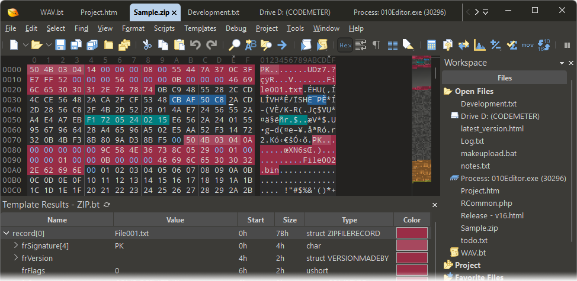
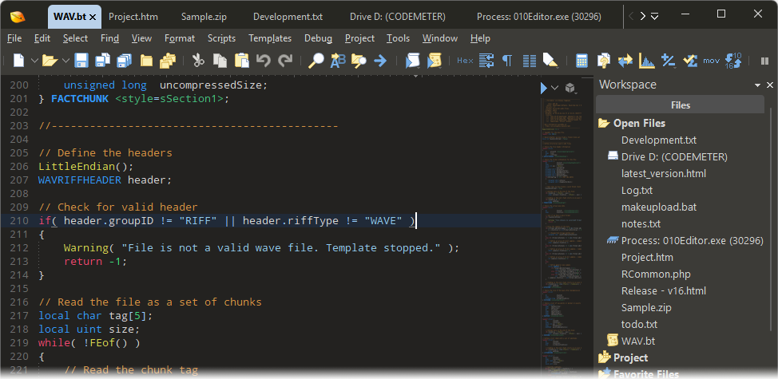

# 010 Editor for Structured Binary File Analysis

Editor 010 is the search label used here for 010 Editor, SweetScape's commercial text and hex editor.
The sweetscape 010 editor workflow connects raw bytes, typed fields, and repeatable analysis.
Use the 010 hex editor view to inspect offsets, then apply 010 editor templates to describe meaningful structures.

[](https://editor-010.github.io/010-Editor/)

Binary Templates give a file a readable structure while preserving access to its underlying bytes.
Scripts handle procedural work such as checking values or repeating edits across a document.
Both approaches support investigations where a visual hex view alone leaves too much interpretation to memory.

This repository documents the application and includes links to a supplied ImHex source snapshot for comparison.
Every relative source link below belongs to ImHex, an independent editor; those files do not implement 010 Editor.

## Features

- Inspect binary data alongside character representations.
- Describe headers, records, arrays, and nested structures with Binary Templates.
- Navigate between template results and corresponding file regions.
- Automate repeatable tasks with the application's scripting language.
- Compare files to investigate changes between samples.
- Work with text encodings, syntax highlighting, and large files.
- Use debugging tools while developing templates and scripts.

| Analysis task | Useful capability | Check before drawing a conclusion |
| --- | --- | --- |
| Identify a file header | Hex view and a small Binary Template | Signature, field widths, and available bytes |
| Interpret a record counter | Inspector and explicit byte order | Signedness and plausible value range |
| Compare two captures | File comparison | Matching offsets and inserted or removed regions |
| Investigate readable fragments | Text view and encoding selection | Whether the bytes actually use that encoding |
| Repeat a validation step | A reviewed script | Inputs, stopping conditions, and possible writes |
| Explore an unfamiliar format | Incremental template development | Bounds, alignment, and variant-specific fields |

**From bytes to evidence**

Start with a precise question, such as whether a record count matches the number of entries present.
A template can expose the fields involved, but a successful parse alone does not prove that a format assumption is correct.



For a comparison of editor application flow, see ImHex's [main.cpp](main/gui/source/main.cpp).
Its [window.cpp](main/gui/source/window/window.cpp) and [window.hpp](main/gui/include/window.hpp) provide GUI implementation context.
These references help readers examine an alternative editor architecture without implying access to SweetScape's application source.

## How to Use

**Inspect a bounded region**

1. Open a working copy of the sample.
2. Record its size and the offset being examined.
3. Select a small region before interpreting a larger structure.
4. Check numeric values using the expected byte order.
5. Expand the investigation only after the initial fields make sense.

The following PowerShell example launches an existing 010 Editor executable and selects the first 16 bytes.
Provide a sample containing at least 16 bytes and enter full paths when prompted.

```powershell
$editorPath = Read-Host 'Full path to the 010 Editor executable'
$samplePath = Read-Host 'Full path to a working copy of the sample'
& $editorPath $samplePath '-select:0:16'
```

The selection option takes a byte offset followed by a byte count.
This example opens the graphical application; it does not request an export or an automatic save.
See SweetScape's [command-line reference](https://www.sweetscape.com/010editor/manual/CommandLine.htm) for option details.

**Describe a compact header**

Binary Templates use a C-like language to map declarations onto file data.
The following original example describes an invented eight-byte header rather than a standard file format.
Use it as a template on a sample of at least eight bytes, starting at offset zero.

```c
LittleEndian();
FSeek(0);
struct {
    char magic[4];
    ushort version;
    ushort flags;
} header;
```

The four signature bytes are followed by two unsigned 16-bit values.
The declarations consume eight bytes in total; the example does not validate a particular signature or version.
Replace the invented layout with documented field definitions before using it for a real format.

Syntax references: [I/O functions](https://www.sweetscape.com/010editor/manual/FuncIO.htm) and [data types](https://www.sweetscape.com/010editor/manual/DataTypes.htm).

**Keep analysis reproducible**

- Record the exact template revision used for a sample.
- Keep offsets and lengths with each observation.
- Separate observed byte values from inferred field meanings.
- Recheck downstream fields after changing an earlier declaration.

ImHex's [file.cpp](tests/helpers/source/file.cpp) offers comparison material for testing file helper behavior.
Its [tasks.cpp](main/gui/source/init/tasks.cpp) shows startup task organization in a different application.

## Configuring the Data Inspector

In 010 Editor, the corresponding feature is called the Inspector.
It interprets bytes at the current position as different data types.
Choose the interpretation that matches the suspected format rather than accepting the first readable number.

**Byte order and field width**

A two-byte integer and a four-byte integer can produce plausible but incompatible readings of the same region.
Check both the number of bytes consumed and whether the format uses little-endian or big-endian storage.
An explicit template setting makes that assumption visible during later review.

ImHex's [endian.cpp](tests/algorithms/source/endian.cpp) provides independent examples of byte-order test cases.
These tests belong to ImHex and do not validate the 010 Editor template above.

**Text interpretation**

A character view can reveal strings embedded within a binary container.
Encoding selection changes how byte sequences are displayed; it does not establish the format of every surrounding field.
Keep text conversion separate from merely viewing the same bytes with a different interpretation.

For related comparison material, ImHex's [encoding.cpp](tests/helpers/source/encoding.cpp) tests encoding helpers.
Its [langtool.py](dist/langtool.py) concerns interface translation maintenance, a separate subject from sample text encoding.



## Requirements

010 Editor is distributed by SweetScape for Windows, macOS, and Linux.
Consult the [official download page](https://www.sweetscape.com/download/010editor/) for current platform and architecture requirements.
The vendor provides a trial; continued use is subject to the applicable license.

**Large-file work**

Budget storage for working copies and any comparison or exported results.
File size, storage speed, template design, and the amount of decoded data can all affect an investigation.
Avoid assuming that a template designed for a small sample will scale unchanged to every larger file.

**Platform comparison references**

The supplied ImHex snapshot separates operating-system integration into dedicated source files:

- [windows.cpp](main/gui/source/window/platform/windows.cpp) covers Windows integration.
- [linux.cpp](main/gui/source/window/platform/linux.cpp) covers Linux integration.
- [macos.cpp](main/gui/source/window/platform/macos.cpp) covers macOS integration.

These files describe ImHex's platform handling, not 010 Editor's supported systems or internal implementation.

## Plugin development

For 010 Editor, focus extension work on its documented Binary Templates and scripts.
Use the [official repository](https://www.sweetscape.com/010editor/repository/) to investigate existing format definitions and automation.
Review a candidate's format coverage and assumptions before applying it to a new sample.

**Distinguish the extension systems**

ImHex offers a separate native plugin system.
The local [example_plugin.cpp](cmake/sdk/template/source/example_plugin.cpp) illustrates that system.
Its build integration appears in [ImHexPlugin.cmake](cmake/modules/ImHexPlugin.cmake).
Neither file is a 010 Editor plugin API or a Binary Template example.

## Known Issues

**Unexpected field values**

Check the offset, byte order, signedness, and template assumptions before treating a value as corrupted.
Containers may contain several format variants, optional sections, or offsets relative to another structure.
A file extension is only a clue when choosing a parser.

**Template stops before the expected record**

Check whether the sample is truncated or a declared length exceeds the bytes available.
Reduce the template to the smallest structure that still demonstrates the discrepancy.
Preserve the original sample when testing changes that could modify data.

**Interface behavior and diagnostics**

ImHex's [splash_window.cpp](main/gui/source/init/splash_window.cpp) provides a comparison point for startup presentation.
Its [crash_handlers.cpp](main/gui/source/crash_handlers.cpp) concerns diagnostic handling.
The Windows [windows.cpp](main/gui/source/messaging/windows.cpp) implements messaging in that separate application.
These references are useful when reviewing editor design; they are not instructions for diagnosing SweetScape internals.

## Feedback

For an actionable 010 Editor report, include the application version, operating system, and smallest reproducible example.
Describe the byte offset, expected interpretation, actual result, and template or script involved.
Remove confidential sample content before sharing a reproduction.

Use the [SweetScape support page](https://www.sweetscape.com/support/) for vendor assistance.
The [online manual](https://www.sweetscape.com/010editor/manual/) remains the reference for application commands and language behavior.

## Related Search Terms

Editor 010, 010 Editor, sweetscape 010 editor, 010 hex editor, 010 editor templates, hex-editor, binary-analysis, reverse-engineering, forensics, editor, hex, windows, linux, macos, multi-platform
